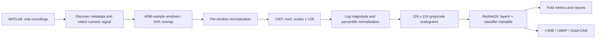

# Sound-Based Rolling Element Bearing Fault Diagnosis

An executed research workflow for classifying rolling-element bearing conditions from acoustic recordings. The project converts MATLAB sound recordings into continuous wavelet transform (CWT) scalograms and fine-tunes a ResNet18 classifier for six bearing conditions. It includes recording-level cross-validation, speed-disjoint evaluation, feature visualizations, and Grad-CAM inspection of a healthy-versus-outer-race confusion pattern.

> **Scope note.** This repository is not a haptic rendering or fractional-order viscoelastic-control project. It contains no force-rendering controller, firmware, motor/encoder interface, FO-SLS model, or real-time control implementation. This README documents only the bearing-diagnosis workflow present in the repository.

## Overview

The main notebook recursively discovers `.mat` recordings, infers acquisition condition, fault class, and nominal speed from their paths and filenames, creates overlapping signal windows, and caches CWT scalograms. It then trains a partially fine-tuned ResNet18 to recognize six classes:

`ball`, `combined`, `healthy`, `inner_race`, `looseness`, and `outer_race`.

Two evaluation workflows are implemented:

- **Recording-level 5-fold CV** over the full recording pool, labelled `Within Speed` by the notebook.
- **Speed-disjoint 4-fold evaluation**, trained on nominal 642 and 1236 RPM groups and tested on the nominal 1809 RPM group.

The generated artifacts are intentionally ignored by Git because they are derived from the data and model runs. They are nevertheless available in a completed local workspace after the notebook has executed.

## Research Motivation and Objectives

The workflow investigates whether time-frequency image representations of acoustic bearing signals can separate healthy, single-fault, and combined-fault conditions, including under a nominal speed shift. Its implemented objectives are to:

1. Create normalized CWT scalograms from acoustic MATLAB recordings.
2. Train a six-class ResNet18 image classifier with recording-level separation between train, validation, and test data.
3. Compare the pooled-CV result with speed-disjoint testing.
4. Inspect learned representations with t-SNE/UMAP and class-discriminative attention with Grad-CAM.
5. Examine the observed healthy/outer-race ambiguity using visual scalogram comparisons.

No claim of field deployment, real-time operation, or generalization beyond these recordings is supported by the repository.

## Dataset and Experimental Rig

The data root is [`Sound Datasets of a Rolling Element Bearing under Various Operating Conditions`](Sound%20Datasets%20of%20a%20Rolling%20Element%20Bearing%20under%20Various%20Operating%20Conditions/). It contains 36 MATLAB recordings:

- two acquisition conditions: with a stethoscope and without a stethoscope;
- six conditions: inner-race fault, outer-race fault, ball fault, healthy bearing, looseness fault, and combined inner/outer/ball faults;
- three nominal speed bins per acquisition-condition/class combination.

The appendix identifies the bearing as a 6004-2ZR grooved ball bearing with a 20 mm bore, 42 mm outer diameter, 12 mm width, nine 6.35 mm balls, and a 31 mm pitch-circle diameter. It also documents a rigid-shaft/disc test rig and cites the Gunt PT 500.12 roller-bearing faults kit. See [Appendix A](Sound%20Datasets%20of%20a%20Rolling%20Element%20Bearing%20under%20Various%20Operating%20Conditions/Appendix%20A.pdf).

The filenames include raw speeds of 600/636/642/648 RPM, 1200/1230/1236 RPM, and 1800/1809/1812 RPM. The notebook maps them to nominal groups `642`, `1236`, and `1809`; these group labels should not be reported as a common exact measured speed across every recording. The supplied files do not document microphone model, placement, fault induction procedure, load protocol, or a public dataset source.

## Implemented System Architecture



The pipeline is offline research processing. It has no hardware-control path: the data-acquisition hardware is described only in the appendix and is not controlled by this code.

## CWT Preprocessing and Model

| Stage | Implemented setting |
|---|---|
| Default sampling rate | 44,100 Hz when a valid sampling-rate variable is absent from a MAT file |
| Window length / hop | 4,096 samples / 2,048 samples (50% overlap) |
| Wavelet | PyWavelets real Morlet, `morl` |
| Scales | 1–128 in a full run; 1–32 in `BEARING_QUICK_RUN=1` |
| Signal normalization | Per-window mean removal and division by standard deviation when non-zero |
| Scalogram transform | `log1p(abs(CWT coefficients))` |
| Image normalization | Per-image 1st–99th percentile clipping, min-max scaling, 8-bit grayscale |
| Image size | 224 × 224 in a full run; 96 × 96 in quick-run mode |
| Training augmentation | ±3% translation, 0.98–1.02 scale, RandomErasing with p=0.15 |
| Backbone | Torchvision ResNet18; ImageNet weights requested by default, with random-init fallback |
| Trainable layers | `layer4` and `Dropout(0.2) -> Linear(512, 6)` head |
| Optimizer / loss | AdamW (1e-4 learning rate, 5e-5 weight decay) / cross-entropy with 0.1 label smoothing |
| Scheduling / stopping | ReduceLROnPlateau on validation macro-F1; early stopping patience 3 |

The CWT frequency vector returned by PyWavelets is not preserved in output metadata. Consequently, generated figures should be interpreted as scale-indexed time-frequency images, not as calibrated, labelled frequency plots.

## Evaluation Protocol

### Pooled recording-level CV

The workflow uses `StratifiedKFold(n_splits=5, shuffle=True, random_state=42)` over unique recording IDs and fault labels. Within every training fold, 20% of the training recordings are set aside stratified by fault for validation. All scalograms from a recording remain in exactly one partition; the notebook asserts no recording-ID overlap between train, validation, and test sets.

Despite the notebook label **Within Speed**, this protocol pools all nominal speed groups rather than independently evaluating each speed. The label should therefore be read as the notebook's experiment name, not evidence of per-speed CV.

### Speed-disjoint evaluation

The cross-speed experiment uses nominal `642` and `1236` groups as the training/validation pool, creates four stratified train/validation folds, and tests every model on the full nominal `1809` group. It asserts both recording and train/test speed disjointness. Each of the four models is evaluated on the same held-out speed group.

## Current Local Run Results

The executed workspace contains 36 recordings and 11,703 cached scalograms. The aggregate metrics stored in [`results/summary.csv`](results/summary.csv) are:

| Experiment | Accuracy | Weighted F1 | Macro F1 | ROC-AUC |
|---|---:|---:|---:|---:|
| Pooled 5-fold CV (`Within Speed`) | 0.697 ± 0.170 | 0.670 | 0.637 | 0.937 |
| Cross speed: 642 + 1236 -> 1809 | 0.782 ± 0.080 | 0.762 | 0.737 | 0.951 |

These values are run-specific, window-level outcomes. They are not a substitute for validation on independently collected recordings. The notebook's `Generalization Gap` field is accuracy-within minus accuracy-cross (`-0.085`), so it represents an improvement in this particular run rather than a degradation.

The generated [`results/per_class_f1_summary.csv`](results/per_class_f1_summary.csv) and [technical summary](results/paper_technical_summary.md) provide the fold-aggregated per-class results and research-reporting caveats.

## Repository Structure

```text
.
├── analysis/
│   └── complete_paper_artifacts.py      # Recreates F1, scalogram, and Grad-CAM artifacts
├── outputs/
│   └── Bearing_Fault_Diagnosis_CWT_ResNet18.ipynb
├── Sound Datasets of a Rolling Element Bearing under Various Operating Conditions/
│   ├── Appendix A.pdf                   # Test-rig specification
│   ├── Test Rig.png
│   ├── Datasets 1- Data acquisition using the stethoscope/
│   │   └── Case 1 ... Case 6/           # Three MATLAB recordings per fault class
│   └── Datasets 2- Data acquisition without using the stethoscope/
│       └── Case 1 ... Case 6/           # Three MATLAB recordings per fault class
├── generated_scalograms/                # Generated, Git-ignored cache
├── models/                              # Generated, Git-ignored checkpoints
├── results/                             # Generated, Git-ignored metrics and figures
├── LICENSE
└── README.md
```

Important generated locations include:

- `results/recordings_metadata.csv`, `segments_metadata.csv`, and `scalograms_metadata.csv`
- `results/*_fold_results.csv`, `*_classification_report.csv`, and `*_predictions.csv`
- `results/confusion_matrices/`, `training_curves/`, `roc_curves/`, `tsne/`, and `umap/`
- `results/gradcam/` and `results/figures/healthy_vs_outerrace_*.png`
- `models/best_resnet18_*.pth`

## Requirements and Setup

Python 3 with the following packages is required:

```bash
pip install numpy pandas scipy PyWavelets matplotlib scikit-learn torch torchvision tqdm pillow ipykernel nbconvert
```

`umap-learn` is optional; the notebook imports it lazily and skips UMAP outputs if unavailable.

From the repository root, create and activate a virtual environment if desired:

```bash
python3 -m venv .venv
source .venv/bin/activate
pip install numpy pandas scipy PyWavelets matplotlib scikit-learn torch torchvision tqdm pillow ipykernel nbconvert
```

> **Reproducibility note:** The repository does not currently include a pinned `requirements.txt`, a lockfile, CUDA version specification, or an environment export. Add these before treating an environment as fully reproducible.

## Running the Workflow

Open and run [`outputs/Bearing_Fault_Diagnosis_CWT_ResNet18.ipynb`](outputs/Bearing_Fault_Diagnosis_CWT_ResNet18.ipynb) from the repository root. The notebook locates the dataset automatically; alternatively set `BEARING_DATA_ROOT` to the data directory.

For a short smoke test, set the following environment variable before opening the notebook in a Jupyter-capable environment (for example, VS Code with its Jupyter extension):

```bash
export BEARING_QUICK_RUN=1
```

Quick-run mode uses scales 1–32, 96 × 96 images, batch size 8, one epoch, two windows per recording, and a smaller embedding sample. It is a pipeline check, not a result-reproduction mode.

For a scripted notebook execution, use:

```bash
jupyter nbconvert --to notebook --execute \
  --output Bearing_Fault_Diagnosis_CWT_ResNet18.executed.ipynb \
  outputs/Bearing_Fault_Diagnosis_CWT_ResNet18.ipynb
```

Other supported environment overrides are `BEARING_DEFAULT_SR`, `BEARING_SEGMENT_LENGTH`, `BEARING_OVERLAP`, `BEARING_CWT_WAVELET`, `BEARING_EPOCHS`, `BEARING_PATIENCE`, `BEARING_LR`, `BEARING_WEIGHT_DECAY`, `BEARING_MAX_SEGMENTS_PER_RECORDING`, and `BEARING_USE_PRETRAINED`.

To recreate the paper-analysis artifacts after the notebook has generated `results/`, `generated_scalograms/`, and `models/`:

```bash
python analysis/complete_paper_artifacts.py
```

The analysis script expects saved reports for five pooled-CV folds, four cross-speed folds, the cross-speed-fold-4 checkpoint, and corresponding metadata files. It is not an alternative trainer.

## Outputs, Logging, and Visualization

The notebook writes metadata, training histories, classification reports, predictions, confusion matrices, ROC curves, t-SNE/UMAP figures, and model checkpoints into the generated locations above. It does not interface with acquisition hardware, stream live audio, or produce a real-time controller log.

`analysis/complete_paper_artifacts.py` additionally produces:

- `results/per_class_f1_summary.csv`
- healthy-versus-outer-race sampled, mean, and difference figures
- Grad-CAM overlays for correct predictions and healthy/outer-race confusion cases

## Implementation Status

| Capability | Status | Evidence |
|---|---|---|
| MAT-file discovery and robust numeric signal selection | Implemented | Executed notebook and recording metadata |
| CWT scalogram caching | Implemented | `generated_scalograms/` and scalogram metadata |
| Six-class ResNet18 training/evaluation | Implemented | Fold reports and saved `.pth` checkpoints |
| Recording-level leakage checks | Implemented | Assertions in the notebook split cells |
| Speed-disjoint evaluation | Implemented | Four cross-speed folds and reports |
| t-SNE / optional UMAP visualization | Implemented | `results/tsne/` and `results/umap/` |
| Grad-CAM follow-up | Implemented | `analysis/complete_paper_artifacts.py` and `results/gradcam/` |
| Hardware interface or live data capture | Not implemented | No source code or configuration found |
| External validation / field deployment | Not implemented | No independent dataset or deployment artifact found |

## Limitations and Future Work

- Only 36 source recordings are available, and overlapping windows from a recording are highly correlated.
- Acquisition condition, fault class, and speed should be treated cautiously because the dataset documentation does not fully describe collection or fault induction.
- The pooled-CV experiment is not strictly per-speed CV.
- Per-image percentile normalization discards absolute-amplitude scale.
- Cross-speed models share a common test speed group across folds; the results are not equivalent to four independent test sets.
- No calibrated CWT frequency axis is saved for the generated scalograms.
- Grad-CAM provides qualitative attention maps, not a physical diagnosis of a fault mechanism.

Useful next research steps are independent-recording and external-dataset validation, documented sensor/placement metadata, calibrated frequency-axis analysis, speed-aware experimental design, and comparisons against signal-native or audio-pretrained models. Any data-driven adaptation should be evaluated with recording-disjoint and condition-disjoint splits before making deployment claims.

## License

This repository is distributed under the [MIT License](LICENSE). Copyright 2026 Ahmad.
